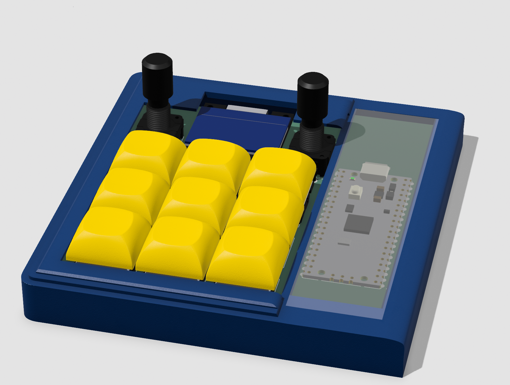
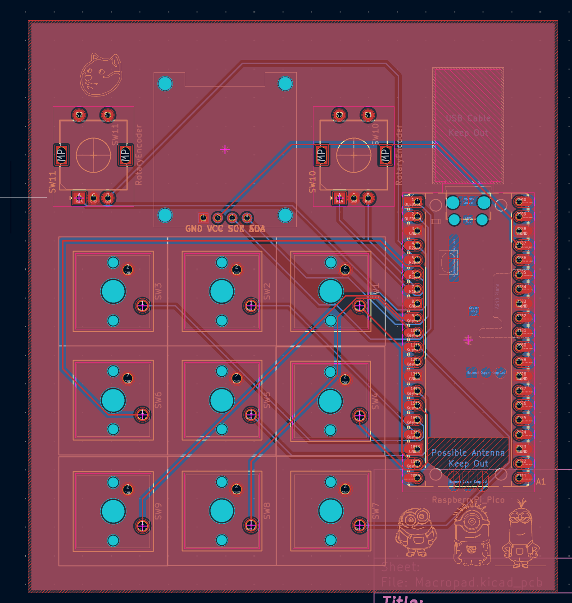
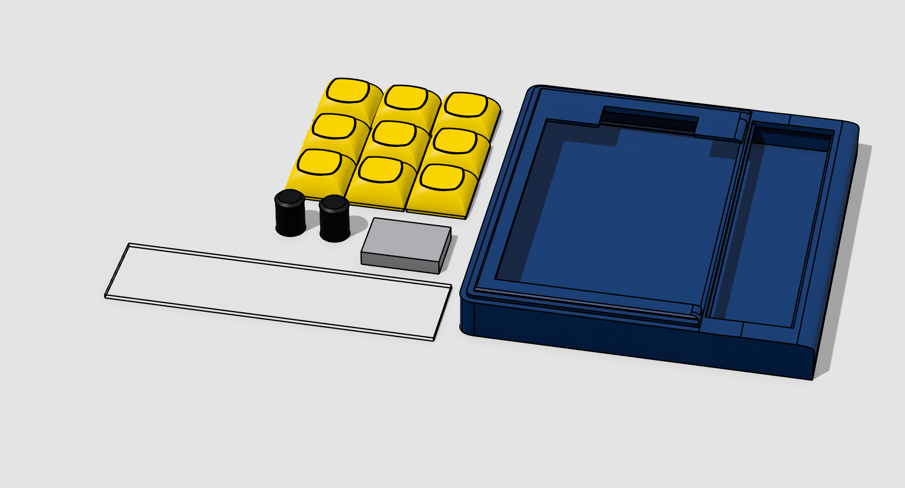

# Minion Micropad
My first macropad build! it contains a Raspberry Pi Pico, 9 MX Cherry switches, 2 rotary encoders and and OLED 128x64 screen alongside a custom silkscreen.

## The PCB

I routed my PCB using KiCad, and have uploaded my project alongside my schematic, PCB file as well as all my manafacturing files. This was my first time creating a custom PCB so it took a while to complete. Here is an image of the final design:

## CAD

I used Shapr3D to design the case for my Macropad, where I used its visualisation tool to see how it would look with certain materials and see how the glass panel would look in my design. I also made custom knobs for the rotary encoder and a stand for my OLED screen. Here is an image of how it looks unassembled with all the individual parts.

